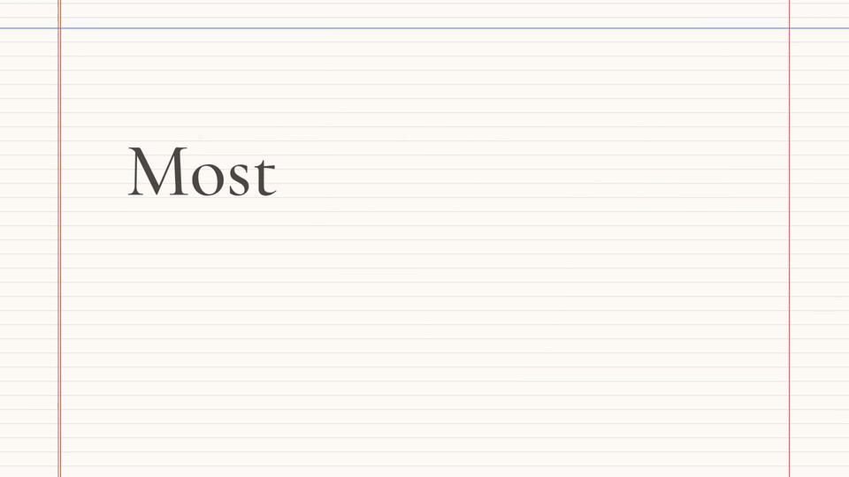

# Margin

**A study desk for PDFs.** Highlight a passage and it lands in a handwritten notebook beside the page, in the exact words and linked to its source. Nothing is summarised or rewritten by AI. The thinking stays yours.

[](https://margin-notes.up.railway.app)

**[Try it live](https://margin-notes.up.railway.app)** with no account needed. The server sleeps when idle, so the first load can be slow; refresh if you get an error.

## Features

- **Highlight to handwriting:** select text and export it to your notes in a handwriting font and color you pick.
- **Go to source:** every note and diagram jumps back to its exact spot in the PDF.
- **Diagram clipping:** drag a box around a figure and place it in your notebook.
- **A real notebook:** draw and write with Excalidraw on lined, dotted, grid or blank paper, then download your notes as a PDF.
- **Multiple PDFs per board:** keep lectures, chapters and handouts in tabs above one notebook.
- **Focus mode:** full-screen Pomodoro sessions with goals, page targets, ambient sounds, stats and streaks.
- **Guest or account:** work with no sign-up in your browser, or sign in with email or Google to keep boards across devices.

## Quick start

Requires Node.js 22+.

```bash
npm install
npm run dev
```

Open <http://localhost:3000>. It runs in guest mode with no setup, and `public/sample.pdf` is there to try.

### Accounts (optional)

1. Create a [Supabase](https://supabase.com) project and run [`supabase/schema.sql`](supabase/schema.sql) once in the SQL Editor.
2. Copy `.env.example` to `.env.local` and set `NEXT_PUBLIC_SUPABASE_URL` and `NEXT_PUBLIC_SUPABASE_ANON_KEY`. Never use the `service_role` key.
3. In Supabase, under Authentication, URL Configuration, add `http://localhost:3000/**` and your deployed domain as redirect URLs. Google sign-in also needs an OAuth client under Providers.

## Good to know

- Guest boards live only in that browser, so clearing site data deletes them. Sign in to upload them to your account.
- Scanned PDFs have no text layer, so they can't be highlighted. Diagram clipping still works.
- Exported PDFs are images of your notes, not searchable text.
- The workspace has no mobile layout, and there is no collaboration or sharing.

## Docs

- [Guide](docs/guide.md): full walkthrough, all limitations, and deploying to Vercel or Railway
- [Architecture](docs/architecture.md): components, data flow and the storage schema

Scripts: `npm run dev | build | start | lint`. There are no automated tests.

## Built with

Next.js, TypeScript, Tailwind CSS, [pdf.js](https://mozilla.github.io/pdf.js/), [Excalidraw](https://docs.excalidraw.com/), [Supabase](https://supabase.com), [idb](https://github.com/jakearchibald/idb), [react-resizable-panels](https://github.com/bvaughn/react-resizable-panels) and [jsPDF](https://github.com/parallax/jsPDF).

## License

[MIT](LICENSE)
